# Mathify — Gamified Math Learning App & UXD Case Study 📐🎮

[](https://reactnative.dev/)
[](https://expo.dev/)
[](https://www.typescriptlang.org/)
[](https://firebase.google.com/)
[](https://reactnativepaper.com/)
[](#usability-validation-results)

<p align="center">
  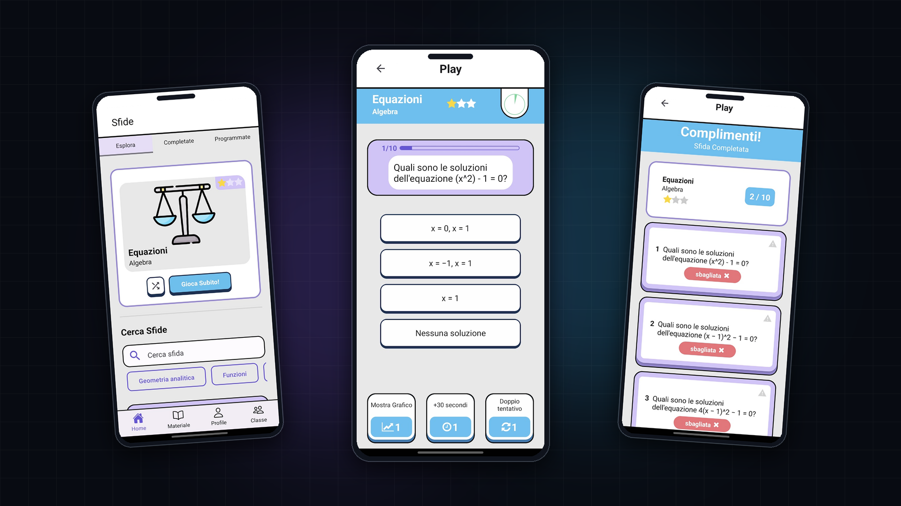
</p>

**Mathify** (*"Play, Learn, Improve"*) is a cross-platform gamified mathematics learning mobile application built with **React Native, Expo, TypeScript, and Firebase Realtime Database** for the **User Experience Design (2024/2025)** M.Sc. course at **Politecnico di Torino** by **Group SmartLearn**.

> 🌐 **Portfolio Case Study:** Read the full engineering and UX design breakdown on [Federico Colombo's Portfolio](https://federicocolombo12.github.io/PortFolio/projects/mathify/).  
> 🇮🇹 *Note: While this documentation is written in English, the mobile app UI, math question bank, and academic UXD deliverables are authored in Italian.*

---

## 📱 Visual App Showcase

| **Explore & Search Challenges (`HomeScreen`)** | **Timed Quiz & Tactical Power-Ups (`PlayScreen`)** |
| :---: | :---: |
| 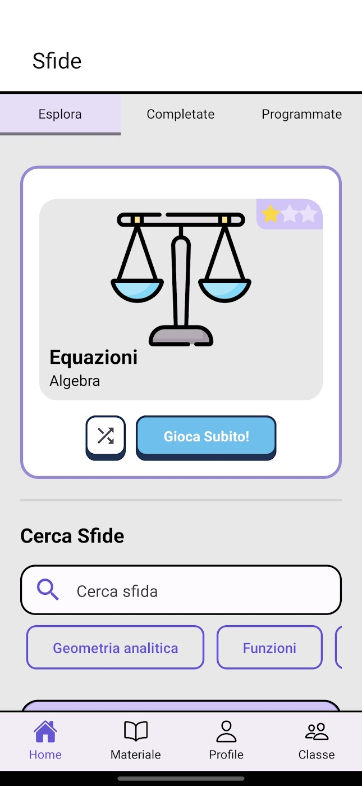 | 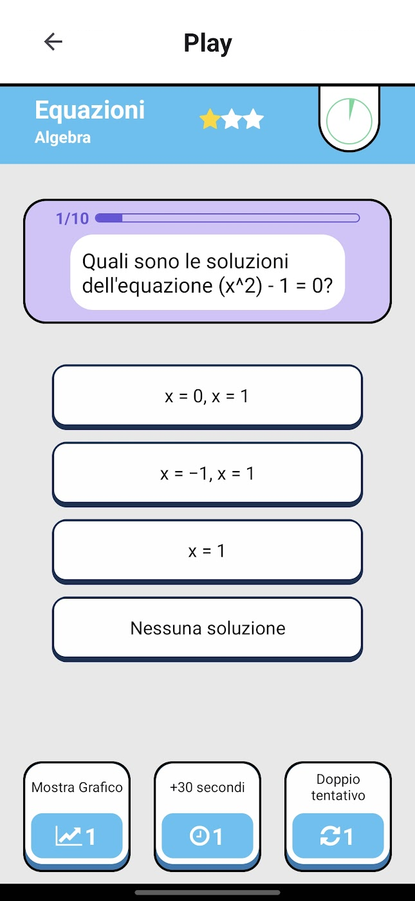 |
| *Topic cards, difficulty stars, and instant category filtering* | *Countdown circle, progress bar & 3 single-use power-ups* |

| **Post-Quiz Review (`PlayScreen` Summary)** | **Crowd-QA Question Reporting (`Segnalazioni`)** |
| :---: | :---: |
| 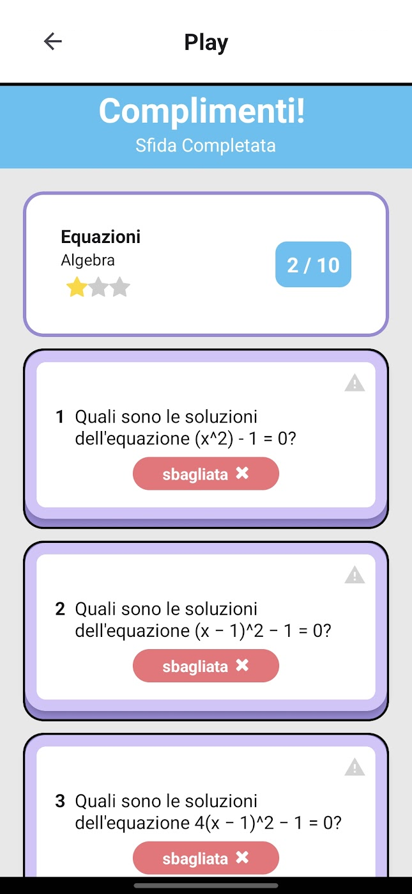 | 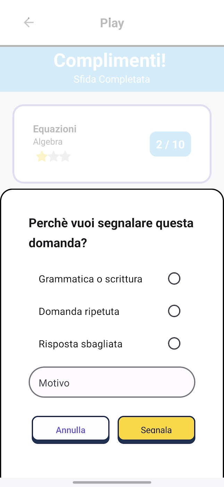 |
| *XP/time breakdown and step-by-step error review* | *Structured error taxonomy persisted directly to Firebase* |

| **Account Verification Gate (`Impostazioni`)** | **Community Study Material (`Materiale`)** |
| :---: | :---: |
| 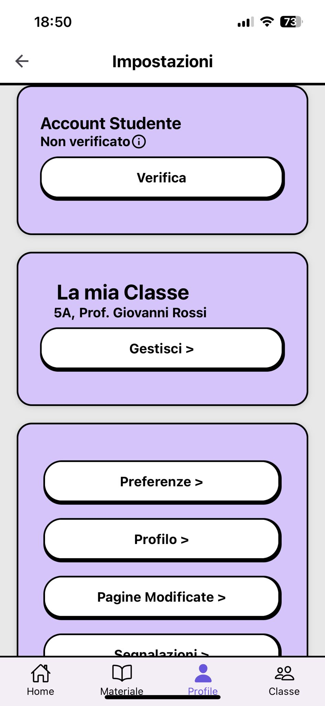 | 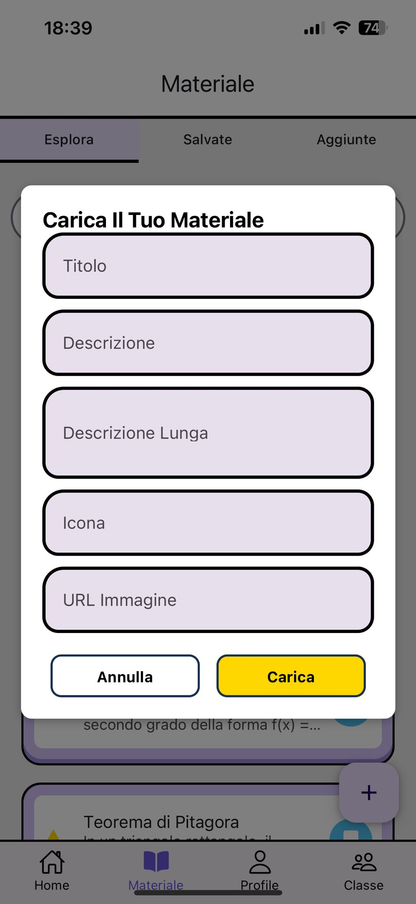 |
| *Level-gated verification (Level ≥ 10) for trusted contributors* | *Student-shared math cards unlocked after verification* |

---

## 🏗️ UX Pipeline & Client Architecture

The project followed a full iterative **User-Centered Design (UCD)** cycle before culminating in the functional React Native & Firebase prototype:

<p align="center">
  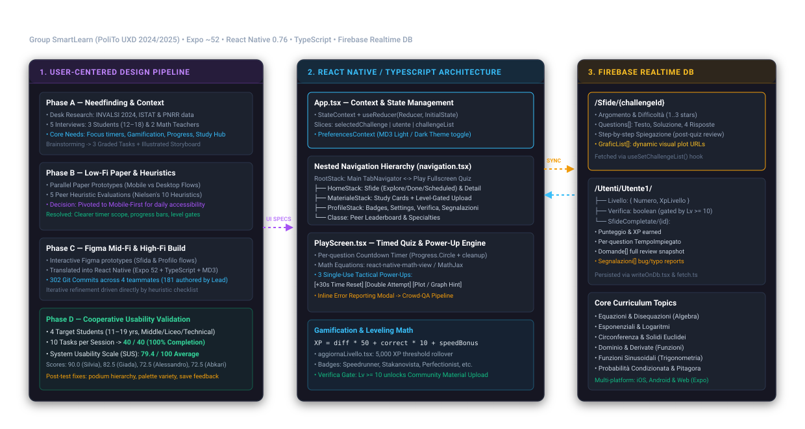
</p>

### Repository Layout (`Mathify/`)

```text
mathify/
├── docs/media/                       # Architecture diagrams, UX artifacts & UI captures
└── Mathify/                          # Expo + React Native TypeScript application root
    ├── App.tsx                       # Root StateContext (useReducer) & PreferencesContext (MD3)
    ├── Reducer.ts & Action.ts        # Unidirectional state updates (selectedChallenge, user, list)
    ├── Firebase.ts                   # Firebase v11 Realtime Database initialization
    ├── Component/
    │   ├── navigation.tsx            # Bottom Tabs + nested Stack Navigators (Home, Profile, Materiale)
    │   ├── Interfaces.tsx            # TypeScript domain models (Sfida, Utente, Question, Segnalazioni)
    │   ├── fetch.ts & writeOnDb.tsx  # Async Firebase RTDB reads/writes & level verification gate
    │   ├── aggiornaLivello.tsx       # 5,000 XP rollover leveling engine
    │   ├── SegmentedButton.tsx       # Topic filtering, search bar & challenge cards
    │   └── CustomModal / RewardModal # Interactive confirmations, power-up & reward feedback
    └── pages/
        ├── HomeScreen.tsx            # Explore / Completed / Scheduled challenge tabs
        ├── PlayScreen.tsx            # Timed quiz loop, bonus logic, XP calc & summary review
        ├── ProfilePage.tsx           # XP bar, badges, activity stats & verification shortcut
        ├── Classe.tsx                # Classroom leaderboard & math topic specialties
        ├── Materiale.tsx / Detail    # Theory repository & level-gated study material creation
        ├── Verifica.tsx              # Level ≥ 10 verification gate handler
        ├── Segnalazioni.tsx          # Tracked question error reports log
        ├── SfidaDetail.tsx           # Collapsible post-challenge answer & explanation review
        └── Impostazioni.tsx          # Preferences, account status & navigation settings
```

---

## 🎯 User Experience Design Process

### 1. Needfinding & Domain Research
* **Secondary Research:** Grounded the problem space in **INVALSI 2024** math competency gaps, **ISTAT** regional education disparities, and **PNRR** digital learning findings alongside gamification research.
* **Primary Interviews:** Conducted 5 semi-structured interviews covering **immediate/lead users** (3 students aged 12–18 across middle school, *liceo scientifico*, and technical institute) and **extreme users** (2 math teachers aged 30 and 50).
* **Core Insights & Design Goals:**
  1. Mitigate digital distraction during home study via timed, focused sessions.
  2. Transform rote exercise into playful, interactive competition (XP, badges, leaderboards).
  3. Provide granular individual progress tracking across math topics.
  4. Bridge traditional homework with accessible digital learning tools.

### 2. Storyboarding & Low-Fi Evaluation
<details>
<summary><strong>📐 View Storyboard, Paper Prototypes & User Flow Diagram</strong></summary>

| **Scenario Storyboard** | **Low-Fi Paper Prototype (Mobile)** | **Complete Navigation Flow** |
| :---: | :---: | :---: |
| 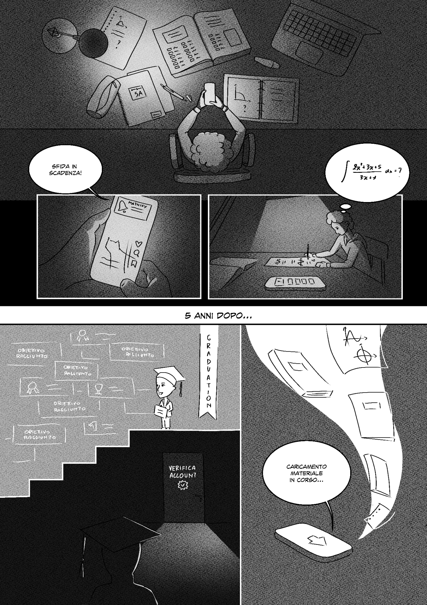 | 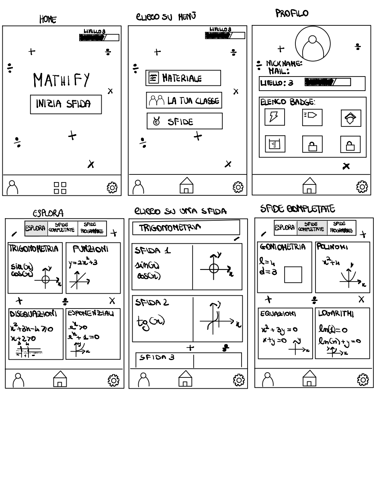 | 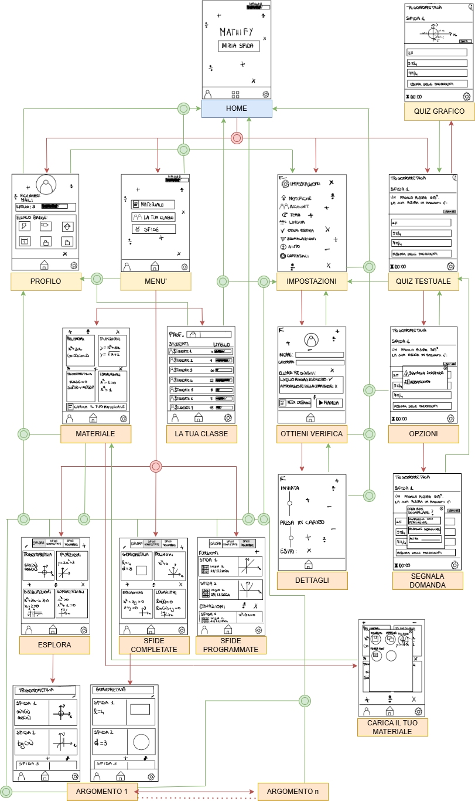 |

</details>

* Evaluated parallel **Mobile** and **Desktop** low-fi paper prototypes against **Jakob Nielsen's 10 Usability Heuristics** via **5 peer evaluations** (3 Mobile, 2 Desktop).
* **Key Strategic Pivot:** Chose the **Mobile-First** direction based on heuristic clarity and teenager smartphone habits, resolving key usability violations before coding: clarifying per-question timer scope, adding in-quiz progress bars, replacing hidden kebab menus with explicit buttons, and adding real-time submission feedback.

### 3. Interactive Figma Mid-Fi Prototypes
Before engineering the React Native build, the refined flows were prototyped interactively in Figma:
* 🧩 [**Challenge Flow Prototype (Pagina Sfida)**](https://www.figma.com/proto/UDJMeTzzTuGo86RtADNy18/Pagina-Sfida?node-id=2-615&node-type=canvas&t=lE3R2y6LwT4AhbOo-1&scaling=scale-down&content-scaling=fixed&page-id=0%3A1&starting-point-node-id=2%3A615)
* 👤 [**Profile & Verification Flow Prototype (Pagina Profilo)**](https://www.figma.com/proto/FKMP5JMc0gD6bJ407JDYRf/Pagina-Profilo?node-id=1-2&starting-point-node-id=1%3A2&t=00hHRhxwoHHTi9tf-1)

---

## ⚙️ Core Engineering Highlights

### Unidirectional State & Persistent Gamification
Global application state is managed via React `useReducer` (`Reducer.ts`) paired with Firebase Realtime Database synchronization (`fetch.ts` and `writeOnDb.tsx`):

```ts
// XP calculation & speed bonus formula (Mathify/pages/PlayScreen.tsx)
const correctAnswers = risposte.filter((risposta) => risposta === true).length;
const xpCorretto = 10 * correctAnswers;
const tempoTotXP = listaTempoDomande.reduce((sum, num, index) => {
    const numArrotondato = Math.round(timerDuration - num);
    return sum + (numArrotondato * (risposte[index] ? 1 : 0));
}, 0);

const totaleXP = state.selectedChallenge.difficolta * 50 + xpCorretto + tempoTotXP;
```

### Level Rollover & Trust Verification Gate
Progress rolls over every **5,000 XP**, and reaching **Level 10** unlocks account verification (`registraVerifica` in `writeOnDb.tsx`) to curate community study materials safely:

```ts
// Level rollover persistence (Mathify/Component/aggiornaLivello.tsx)
const xpPerLivello = 5000;
while (xpTotali >= xpPerLivello) {
    xpTotali -= xpPerLivello;
    livelloAttuale += 1;
}
await update(ref(db, `Utenti/Utente1/Livello`), {
    XpLivello: xpTotali,
    Numero: livelloAttuale,
});
```

---

## 🧪 Usability Validation Results

Conducted cooperative usability testing with **4 students** (aged 11–19 from middle school, *liceo scientifico*, and vocational high school), each executing **10 representative tasks** followed by the standardized **System Usability Scale (SUS)**:

| Participant | Age / School | Tasks Completed | SUS Score | Key Qualitative Feedback |
| :--- | :--- | :---: | :---: | :--- |
| **Test 1 — Silvia** | 18 · *Liceo Scientifico* | 10 / 10 | **90.0 / 100** | Highly intuitive quiz & summary flow; suggested quicker access to Verification. |
| **Test 2 — Alessandro** | 19 · *Istituto Alberghiero* | 10 / 10 | **72.5 / 100** | Appreciated profile layout; asked to enlarge the leaderboard podium and color variety. |
| **Test 3 — Giada** | 19 · *Istituto Alberghiero* | 10 / 10 | **82.5 / 100** | Found navigation clear and calming; suggested visual refinements to leaderboard charts. |
| **Test 4 — Abkari** | 11 · *Scuola Media* | 10 / 10 | **72.5 / 100** | Immediately understood quiz gameplay; wanted higher color contrast on key actions. |
| **Overall Benchmark** | **4 Participants** | **40 / 40 (100%)** | **79.4 / 100 Avg** | Above-average usability benchmark; directly informed final contrast & podium polish. |

### Known Prototype Scope & Limitations
To remain transparent about the academic prototype scope:
* **Dynamic vs. Hardcoded Data:** 3 core challenges, user XP/level rollover, completed challenge history, earned badges, question error reports (`Segnalazioni`), and account verification sync dynamically with Firebase Realtime Database, while additional explore cards, class leaderboard (`Classe.tsx`), scheduled dates (`SfideProgrammate.tsx`), and auxiliary settings items use local sample data.

---

## 👥 Team SmartLearn & Contributions

Developed at **Politecnico di Torino** (M.Sc. in Cinema and Media Engineering — *User Experience Design*):
* **Federico Colombo** — *Lead React Native & Firebase Developer* (**181 / 302 commits** on `main` covering state management, Firebase RTDB sync, quiz engine, navigation, modals & UI refinement) + UXD co-author across needfinding, wireframing, heuristics, and usability analysis.
* **Ilaria Arduino** — Co-designer & React Native developer (**57 commits**, badges, reward feedback & UI styling).
* **Alice Carlotta La Greca** — Co-designer, usability test observer & React Native developer (**33 commits**).
* **Alberto Fulcheri** — Co-designer, usability test facilitator & React Native developer (**31 commits**).

---

## 🚀 Running Locally

```bash
# 1. Clone the repository
git clone https://github.com/polito-uxd-2024/mathify.git
cd mathify/Mathify

# 2. Install dependencies
npm install

# 3. Start the Expo development server
npx expo start

# Optional: launch directly in Web, Android, or iOS simulator
npm run web
npm run android
npm run ios
```
